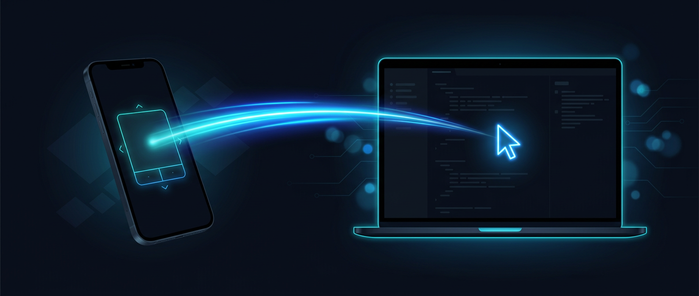
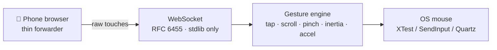

<div align="center">



# 📱 Phone Mouse

### *Your phone. Your touchpad. Zero installs.*

Turn your phone's screen into a **real-time touchpad** for your laptop —
with pointer acceleration, scroll momentum, pinch-zoom, and drag, just like
the real thing. No app to install. No dependencies to pip-install.
Just `python3 server.py` on the laptop and a web page on the phone.

<br>


<br>

[**⚡ Quick Start**](#-quick-start-30-seconds) ·
[**🖱️ Gestures**](#️-gestures) ·
[**🏗️ How It Works**](#️-how-it-works) ·
[**🧪 Development**](#-development-test-driven) ·
[**🛠️ Troubleshooting**](#️-troubleshooting)

</div>

---

## ✨ Why Phone Mouse?

| | |
|---|---|
| ⚡ **Real-time** | WebSocket link with animation-frame coalescing — feels like a built-in touchpad, not a remote app |
| 🪶 **Zero dependencies** | Pure Python standard library. The WebSocket layer is hand-rolled RFC 6455 — `python3 server.py` just works |
| 🎯 **True touchpad feel** | Relative movement, pointer acceleration, scroll inertia, long-press drag — one gesture engine, fully tested |
| 🔒 **Paired & managed** | Token pairing, heartbeat + live latency, dead-connection timeout, auto-reconnect with backoff |
| 🖥️ **Native mouse control** | Linux XTest · Windows `SendInput` · macOS Quartz — auto-detected, with graceful demo fallback |
| 📲 **No app install** | The phone just opens a web page. Works on any modern mobile browser |

---

## 🚀 Quick Start (30 seconds)

**1. On your laptop:**

```bash
python3 server.py
```

It prints a URL like `http://192.168.1.10:8765/?token=AbC123…` and the
mouse backend it detected.

**2. On your phone** (same Wi-Fi as the laptop): open that URL.
The touchpad is live instantly — the token in the URL pre-pairs the phone.

> 💡 **Try it first in your browser:** `python3 server.py --demo` runs with a
> virtual cursor (token `demo`), so you can test the page on any device
> without touching the real mouse.

---

## 🖱️ Gestures

| Gesture | Action |
|---|---|
| ☝️ 1-finger drag | Move cursor *(relative, with pointer acceleration)* |
| 👆 Tap | Left click |
| 👆👆 Double-tap | Double click |
| ✋ Press & hold still | Drag *(press-and-hold)* |
| ✌️ 2-finger drag | Scroll |
| ✌️💨 2-finger flick + release | Scroll with momentum |
| 🤏 Pinch / spread | Zoom *(Ctrl + scroll)* |
| ✌️👆 2-finger tap | Right click |

On the page you can also adjust **speed**, **invert Y**, and use the
Left / Right / Double click buttons. The screen stays awake while
connected (Wake Lock), and the link auto-reconnects if Wi-Fi blips.

---

## 🏗️ How It Works



- The phone streams **raw touches**; one gesture engine on the laptop
  interprets them — a single source of truth for touchpad behaviour.
- **Real-time feel:** moves are coalesced to animation frames, sequence
  numbers drop duplicates / out-of-order packets, and pointer acceleration
  makes slow drags precise and fast flicks long — like a real touchpad.
- **Managed connection:** token pairing, heartbeat ping/pong with latency
  readout, dead-connection timeout, single-controller takeover (a fresh
  connection evicts a stale one), and auto-reconnect with backoff.
- **Zero dependencies:** the WebSocket layer is hand-rolled RFC 6455 on
  the standard library, so `python3 server.py` just works.

### Mouse backends (auto-detected)

| Platform | Backend | Notes |
|---|---|---|
| 🐧 Linux (X11) | XTest via ctypes | Direct X calls — touchpad-level latency |
| 🪟 Windows | `SendInput` via ctypes | Relative moves + wheel |
| 🍎 macOS | Quartz `CGEvent` via ctypes | Native events |
| 🖥️ Headless / Wayland / unknown | Demo *(virtual cursor)* | Server explains why; page shows the virtual cursor |

Force one with `--mouse null|xtest|windows|mac`. Wayland has no global
input injection without a portal, so on Wayland the server runs in demo
mode — run an X11 session (or XWayland) for real control.

### Options

```bash
python3 server.py --port 8765 --token MYTOKEN --sensitivity 1.5
python3 server.py --demo          # virtual cursor, token "demo"
```

---

## 🧪 Development (test-driven)

Built test-first: **128 tests** covering the protocol schema, the gesture
engine (fake-clock, deterministic), RFC 6455 framing (including the RFC's
own test vectors), session auth / heartbeat / sequencing, every mouse
backend's event translation (via injected fakes — no display needed), and
end-to-end WebSocket tests against a live server.

```bash
./run_tests.sh
```

```
Ran 128 tests in 7.0s
OK
```

---

## 🛠️ Troubleshooting

<details>
<summary><b>Phone can't reach the URL</b></summary>

Same Wi-Fi? Firewall blocking the port? Allow Python on your firewall
for the chosen port (default `8765`).

</details>

<details>
<summary><b>Cursor doesn't move on the laptop</b></summary>

Check the backend line at startup. On Linux, `echo $DISPLAY` must be set
(X11 session). On Wayland, use an X11 session or `--demo` mode.

</details>

<details>
<summary><b>Page says "enter pairing token"</b></summary>

Open the full URL including `?token=…`, or type the token shown in the
server banner on the laptop.

</details>

---

<div align="center">

**Built with Python's standard library only — no installs, no fuss.** 🐍✨

*Your phone is already in your pocket. Now it's a touchpad too.*

</div>
